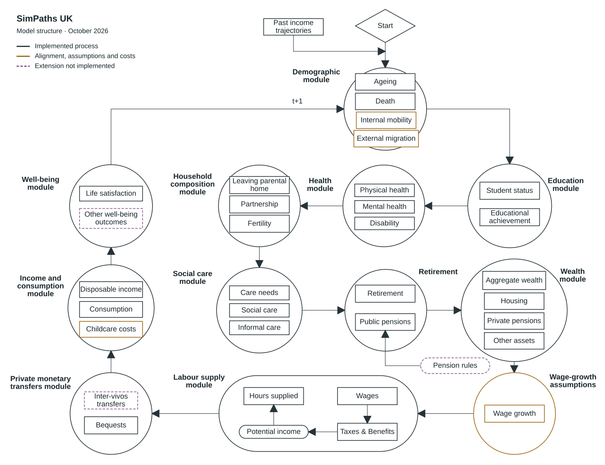

# Model overview {#model-description}

SimPaths is a family of models for individual and household life course events, all sharing common components. The framework is designed to project life histories through time, building up a detailed picture of career paths, family (inter)relations, health, and financial circumstances. It builds upon standardised assumptions and data sources, which facilitates adaptation to alternative countries.

The framework is fully open source and coded in Java using the [JAS-mine](../jasmine-reference/index.md) simulation libraries. This overview describes the UK model.

The modular nature of the SimPaths framework is designed to facilitate analysis of alternative assumptions concerning the tax and benefit system, sensitivity to parameter estimates, and alternative approaches for projecting labour/leisure and consumption/savings decisions.

## Population and model components {#simulated-modules}

SimPaths implements a hierarchical architecture where individuals are organised in benefit units for fiscal purposes, and benefit units are organised in households. A benefit unit consists of a single adult or couple and any dependent children; a household can contain more than one benefit unit. The UK [initial population](../getting-started/data/initial-population-uk.md) is derived from Understanding Society, the UK Household Longitudinal Study.

The model projects data at yearly intervals, reflecting the yearly frequency of the survey data used to estimate model parameters. Each module contains one or more processes; for example, the ageing module covers ageing, mortality, child maturation and population alignment. Processes use characteristics projected by other modules, linking changes in education, family circumstances, health and economic outcomes.

<section class="model-overview__components" aria-label="Model components" markdown>

The individual modules are documented in the following sections:

- [Ageing](modules/ageing.md)
- [Education](modules/education.md)
- [Health](modules/health.md)
- [Family composition](modules/family-composition.md)
- [Social care](modules/social-care.md)
- [Investment income](modules/investment-income.md)
- [Labour income](modules/labour-income.md)
- [Disposable income](modules/disposable-income.md)
- [Consumption](modules/consumption.md)
- [Mental health](modules/mental-health.md)
- [Statistical display](modules/statistical-display.md)

</section>

## How the simulation operates {#how-the-model-works}

### The annual cycle

The diagram shows the model's components and their connections. It describes the conceptual structure; the order of calculations is set by the [annual event schedule](../developer-guide/internals/simpaths-model.md).

<figure class="module-diagram">
  

</figure>

<section class="diagram-key" aria-label="Diagram notes">

Implementation notes

<dl>
<dt>Wealth and transfers</dt>
<dd>The model includes aggregate wealth accounting under intertemporal optimisation and separate housing, financial and private-pension projections controlled by configuration switches. Bequest settlement distributes estates after death; it does not model transfers between living people. These asset projections and bequest processes are implemented in the development model but have not yet been included in the latest release. Inter-vivos transfers remain proposed.</dd>
<dt>Population, wages and childcare</dt>
<dd>Internal mobility and external migration use population alignment to adjust the population to demographic targets, rather than modelling migration decisions. Wage growth comes from external time-series assumptions. Childcare calculations represent formal use and expenditure, not general childcare time allocation.</dd>
<dt>Well-being and pensions</dt>
<dd>Life satisfaction and public pension income are already represented. Additional well-being outcomes and dedicated pension-rule imputation remain proposed extensions; the latter is a separate method of projecting entitlements.</dd>
</dl>

This diagram describes the UK model. See the <a href="../developer-guide/internals/simpaths-model/">event schedule</a> for execution order and the <a href="roadmap/">development roadmap</a> for planned work.

<a class="diagram-key__full-size" href="../assets/images/model-structure-uk.svg" target="_blank" rel="noopener">Open full size ↗</a>
</section>

Each year, the model stores previous-year states and updates ages, education, homeownership, general health and potential wages. Partnership and fertility processes establish family circumstances before care, labour supply and income are evaluated. Consumption is then projected, followed by financial distress, mental-health and well-being outcomes. Mortality and population alignment occur towards the end of the year. The initial year uses a reduced schedule because many starting characteristics are supplied by the input data.

### Transitions and individual variation

Many demographic, family and health transitions are projected using equations estimated from survey data. For a discrete outcome, an equation supplies probabilities conditional on individual and family characteristics, and a random draw determines the realised outcome. These characteristics can include previous-year states and outcomes from other modules. Earlier circumstances therefore influence later outcomes, while changes in one part of a person's life can affect others.

### Economic decisions and policy

The labour-supply model represents choices between working-hours alternatives through preferences over disposable income and leisure. Disposable income under each alternative is imputed from precomputed UKMOD tax–benefit results, using the benefit unit's circumstances. A tax–benefit reform can therefore change both income at given working hours and the incentives to work. The [labour-income](modules/labour-income.md) and [disposable-income](modules/disposable-income.md) pages describe these calculations.

An alternative, forward-looking specification chooses employment and discretionary consumption jointly, based on expected utility over the remaining lifetime. Explicit non-pension wealth projections are also available without forward-looking optimisation: in that configuration, discretionary consumption is projected using an estimated equation. When neither forward-looking optimisation nor non-pension wealth projections are enabled, consumption follows an income-based rule with an assumed saving adjustment for non-retired people.

## Parameters, validation and uncertainty {#defining-and-interpreting-a-projection}

[Model parameterisation](parameterisation.md) describes the data, estimated parameters and external assumptions used to define a projection. Separate sections explain [model validation](../validation/index.md) and [uncertainty analysis](../user-guide/uncertainty-analysis.md).

For the model's design and methodological foundations, see [Bronka et al. (2025), *SimPaths: an open-source microsimulation model for life course analysis*](https://microsimulation.pub/articles/00318).

[Development roadmap](roadmap.md) · [How to cite](how-to-cite.md)

